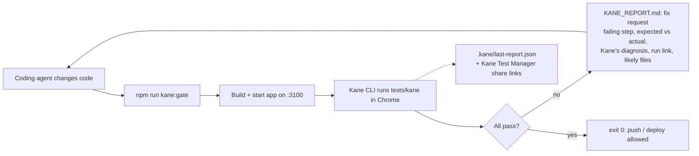

# Rails Desk

Rails Desk is a control desk for agent payments. Agents can propose transfers, but deterministic rails decide whether a proposal is approved, needs a person, or is blocked. Approval can be cancelled before the explicit execution step.

The demo has two modes:

- **Demo (mock)**: fully simulated, no wallet needed. This is the default.
- **X Layer testnet**: after you approve, you sign the transfer in your own browser wallet on X Layer testnet (chain 1952). The receipt hash is written into the transaction.

In both modes, the rails are also evaluated as a TapeOut circuit, and recipients can be TapeOut identities read from X Layer. See [X Layer and TapeOut](#x-layer-and-tapeout).

## Scope and safety

- No real funds. X Layer mode uses X Layer **testnet** only, signed in the user's own wallet. Rails Desk never holds a private key.
- TapeOut reads use X Layer mainnet `eth_call` only: no transactions, no gas.
- Spending-cap and case-insensitive recipient allowlist checks are deterministic.
- Approval, refusal, and cancellation are recorded with their reason.
- Existing browser receipts are preserved in localStorage as separate legacy history; they are not deleted or silently migrated.
- New app approvals, policy refusals, user refusals and cancellations append to the same JSON Lines file at `data/receipts.jsonl`.
- The app receipt page reads that file through the Node API route and displays the same chain checked by the CLI verifier.
- The Node route re-evaluates each proposal against the configured rails included with the request before recording an approved mock execution. This is still a local demo with no user accounts or authentication, not a production security boundary.

The file-backed log is suitable for a local Node development process with a writable project directory. It is not a production database. Vercel/serverless filesystems are ephemeral and the project directory may be read-only, so this file is not durable or reliable across invocations or instances there. Configure a persistent database or object store before deploying for real use. Anyone with filesystem access can rewrite the entire file and recompute its hashes; the chain is tamper-evident, not immutable.

## Local setup

Requires Node.js 20+ and npm.

```bash
npm ci
npm run dev
```

Open http://localhost:3000.

## Tests and checks

```bash
npm test
npm run lint
npm run build
```

## Local file receipt log

Append a mock receipt. The same deterministic default rails apply: cap 20, recipients Alex, Jordan, and Sam.

```bash
npm run receipts:append -- --amount 10 --recipient Alex --reason "local test receipt"
```

Check the full chain:

```bash
npm run receipts:verify
```

A valid chain prints `VALID · N entries`. A failed check prints `BROKEN · first broken entry: N` and exits non-zero. The verifier stops at the first malformed, altered, misnumbered, or incorrectly linked entry. It refuses to append to a broken chain.

For isolated tests, pass a separate file path:

```bash
node scripts/receipts.mjs append --amount 10 --recipient Alex --reason "isolated" --file /tmp/rails-desk-test.jsonl
node scripts/receipts.mjs verify --file /tmp/rails-desk-test.jsonl
```

The test suite uses temporary directories and does not touch `data/receipts.jsonl` or existing browser localStorage data. API route tests call the actual GET/POST handlers directly; no server is started.

## Existing browser receipts

Existing browser receipts are loaded into a separate preserved-history section and remain in the original localStorage key. New app decisions are written to the file-backed chain; the receipt page displays that file chain and its server-side verification status. The CLI verifier checks the same file. The two histories are deliberately kept separate because the app cannot safely assume it can rewrite or migrate an individual user's browser data.

## Verified with Kane CLI

Rails Desk is built by an AI coding agent (the Grok Bot coding agent) and verified by [Kane CLI](https://www.testmuai.com/kane-cli/) from TestMu AI. Kane drives a real Chrome through the flows in `tests/kane/*_test.md`, written in plain English, and decides pass or fail. Its verdict goes straight back to the coding agent: **the agent isn't done until Kane is green.**

### The loop



- **`scripts/kane-gate.mjs`** (`npm run kane:gate`) builds the app, starts it, runs Kane with `kane-cli testrun run --agent`, and parses Kane's NDJSON stream and per-test session logs. It writes `.kane/last-report.json` (machine-readable) and `KANE_REPORT.md`, then exits **1 on any failure** (2 on setup errors).
- **`KANE_REPORT.md` is a re-prompt for the agent.** On failure it contains a "Fix request for the coding agent" section with the failing step, expected vs actual values, Kane's own diagnosis, the Kane run link (video, steps, screenshots) and the source files and lines that contain the words Kane flagged.
- **Agents are told to use it.** [`AGENTS.md`](AGENTS.md), [`CLAUDE.md`](CLAUDE.md) and [`.cursor/rules/kane-gate.mdc`](.cursor/rules/kane-gate.mdc) require the agent to run the gate after every change and keep fixing until the report says PASS.
- **Red blocks shipping.** `npm run hooks:install` enables a [`pre-push`](.githooks/pre-push) hook that runs the gate. `npm run deploy` runs it first through `predeploy`. [`ci/kane-gate.yml`](ci/kane-gate.yml) is a GitHub Actions workflow that runs it on every PR. Copy it into `.github/workflows/` and add the repo secrets `LT_USERNAME` and `LT_ACCESS_KEY`. Without secrets it skips instead of failing, so forks and Vercel builds don't break.

### Fail → fix → pass (real run, Nov 20, 2026)

| Step | Commit | What happened | Kane run |
|---|---|---|---|
| 1. New requirement | `0147902` | Added `tests/kane/demo-blocked-wording_test.md`: a blocked payment must say "Blocked" in the circuit rule, the referee status pill and the receipt. | |
| 2. Kane **fails** | `4c74d62` | The gate exited 1. Kane: *"The checked Mallory proposal shows Refused in the status and receipt, so required Blocked checkpoints cannot pass."* See [the report](docs/kane-evidence/01-fail-blocked-wording.md). | [failed run](https://test-manager.lambdatest.com/projects/01M7TXC9HAMFHFKZW2RB009S89/test-cases/01M7V0R1CZ9AR5HYC0R09S8529/dashboard/share/US_JD4PJKNGQ12XDJMQT0KJK2QREULES6L2AM622HSWS2PUQDN80W99VH6CNTV7Q19Y?type=summary&agentView=true&fqdn=summary-page) |
| 3. Agent improves the hint | `a327bb9` | Reading the report, the agent narrowed the gate's likely-file hints to the words Kane flagged. Re-rendered from the saved run with no new Kane credits, it now points to the `"Refused"` lines in `src/app/demo/page.tsx`. | |
| 4. Agent fixes the app | `7b8bdd7` | Blocked proposals get their own `blocked` stage, so the pill and receipt now say "Blocked". "Refused" is kept for a manual refusal, and "Cancel instead" after approval now records "Cancelled". | |
| 5. Kane **passes** | `71b1806` | The gate exited 0 with 3/3 passing. See [the report](docs/kane-evidence/02-pass-after-fix.md). | [blocked wording](https://test-manager.lambdatest.com/projects/01M7TXC9HAMFHFKZW2RB009S89/test-cases/01M7V1SX4CRCNXE1CMC5HD2R6K/dashboard/share/US_CFBPIT8W4D2AY6EKGEBKMSG242FVRZTKJJS3E6IYBV0MEK29N5YPB55LOEBNYU7D?type=summary&agentView=true&fqdn=summary-page) · [allowlist](https://test-manager.lambdatest.com/projects/01M7TXC9HAMFHFKZW2RB009S89/test-cases/01M7V1R38ACP7QX0FBP05EPTBT/dashboard/share/US_MKPY4F3RDX1KPJP5DSO5D3VUNYVKVCHY7D2M8PSM7YALPL679YA60TYV7OB7254E?type=summary&agentView=true&fqdn=summary-page) · [circuit labels](https://test-manager.lambdatest.com/projects/01M7TXC9HAMFHFKZW2RB009S89/test-cases/01M7V1W1D2J5HV8QDSZCPTJDBD/dashboard/share/US_7IY0PPNL02PAQGUC8VDB8GGHYQDVUVN0GCDTXMO5KEV8BPZW85C1U0CEUCUTJRYQ?type=summary&agentView=true&fqdn=summary-page) |

Kane caught a real UX inconsistency that the unit tests (`npm test`, 26 passing) couldn't see. The policy logic was right, but the user was shown two different words for the same outcome.

### Run it

```bash
npm install -g @testmuai/kane-cli@0.10.6        # once; Chrome must be installed
# LT_USERNAME / LT_ACCESS_KEY in your env or a gitignored .env (see .env.example)
npm run kane:gate                               # build, start, test everything, write KANE_REPORT.md
npm run kane:gate -- --match demo-blocked       # only matching tests (saves credits while iterating)
npm run kane:gate -- --url https://my-preview.vercel.app   # test a deployment instead
npm run kane:gate -- --from .kane/runs/<ts>/kane-stdout.ndjson   # re-render a saved run, no credits
npm run hooks:install                           # block git push on a red gate
```

The committed tests in `tests/kane/` cover:
- the landing-page demo entry
- the TapeOut policy-circuit labels (Approved / Needs your OK / Blocked)
- consistent "Blocked" wording
- a review-and-mock-execution flow
- an allowlist block
- the `/xlayer` TapeOut identity lookup

Tests stay in Demo (mock) mode: no wallet connection and no real transfers (see `.testmuai/context.md`). Credentials are read only from the environment and are never printed, logged or committed. The older `npm run test:kane` runner (`scripts/run-kane-tests.sh`, `BASE_URL`, default `http://127.0.0.1:3000`) still works for ad-hoc runs against an app you started yourself.

## X Layer and TapeOut

Built for X Layer TapeOut Accelerate. Everything below is new on the `feat/xlayer-tapeout` branch.

| What | Where | Status |
|---|---|---|
| Transfers on approval | X Layer testnet (1952), `src/lib/xlayer-wallet.ts` | Real testnet transactions from an injected wallet (OKX Wallet, MetaMask…). Pays test OKB by default, or a testnet ERC-20 if `NEXT_PUBLIC_XLAYER_TESTNET_TOKEN` is set |
| Receipts anchored on chain | calldata of each transfer | `"RDK1"` tag + SHA-256 of the receipt. `/xlayer` re-reads the tx and checks it |
| TapeOut identities | X Layer mainnet, `src/lib/tapeout.ts` | Names like `#1@2.254` resolve through the TapeOut factory (`cpuAt`), the circuit NFT (`ownerOf`) and the container opener (`accountOf`, `isOpened`). Payments go to the open container, else the holder |
| Policy circuit | `src/lib/policy-circuit.ts` | Rails compiled into a 938-gate NAND netlist in TapeOut's TAP-02 format (97 inputs, 3 outputs). Evaluated in the app on every check; confirmed with `eval` on X Layer once taped out |

TapeOut contracts on X Layer mainnet (from TapeKit `kernel/src/config.js`): factory `0x1f09DAeFA827f02CBb40967cc91b259763760761`, container opener `0x536adD8F30f03b69f6fbF29d425A816A0dC50106`, site registry `0xd6EFb7adCc9c83dC4924Ad56f6a8E4e969b9ADB6`, DeWEB hub `0xe61A9C7213a6Aa616C246a2B569e555B417b25ee`.

### Try X Layer mode

1. Add X Layer testnet to your wallet (the app asks to switch automatically): chain 1952, RPC `https://testrpc.xlayer.tech/terigon`, explorer `https://web3.okx.com/explorer/x-layer-testnet`.
2. Get test OKB from the faucet: https://web3.okx.com/xlayer/faucet
3. Open `/demo`, choose **Connect wallet**, propose e.g. Alex · 12, check, approve, then **Send on X Layer testnet**. By default the named payees pay your own wallet (a self-transfer), so only gas is spent. Set `NEXT_PUBLIC_DEMO_PAYEES` to use other addresses.
4. Open `/xlayer` to see the receipt and press **Verify on chain**.

Settings are in `.env.example`. They are all public `NEXT_PUBLIC_*` values; never add a private key.

### Tape out the policy circuit (optional, mainnet)

```bash
npm run circuit -- export --out policy-circuit.json   # netlist, gate count, SHA-256
npm run circuit -- calldata                            # calldata for tapeout(bytes,uint32,uint32)
```

Taping out is a mainnet transaction, so it is done by the owner in their own wallet, never by this repo. On X Layer a processor charges `TAPEOUT_FEE` (0.0013 OKB on the processors checked) and burns one transistor token per gate (938). A read-only simulation against processor 254 on X Layer passed the netlist checks and stopped only at the transistor burn (`ERC1155InsufficientBalance … needed 938`). After taping out:

```bash
npm run circuit -- check --processor 0x... --id N      # read-only: compares bytes and runs eval
```

Then set `NEXT_PUBLIC_TAPEOUT_POLICY_PROCESSOR` and `NEXT_PUBLIC_TAPEOUT_POLICY_CIRCUIT_ID`. Every check then calls `eval` on X Layer and blocks the proposal if the chain and the app disagree.

### Not done yet

- TapeSend messages: the DeWEB hub exists on X Layer, but sending needs an opened circuit container and wallet-derived keys. A natural next step is sending each receipt to the agent's container.
- DeWEB hosting: DeWEB serves static files from a circuit container. The demo pages could be exported statically, but the receipt API route cannot run there.
- The file-backed receipt log (`data/receipts.jsonl`) is not durable on Vercel. Onchain receipts are kept in the browser, and the transaction itself is the lasting record.

