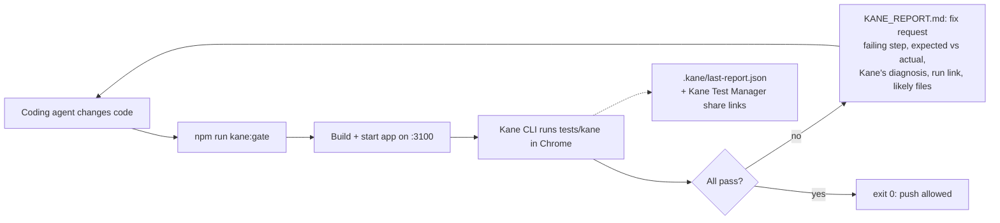

# Rails Desk

Rails Desk is a safety layer for AI agents that propose payments. An agent sends a request; the desk checks it against rules you set and returns **approved**, **needs your OK**, or **blocked**, with a SHA-256 hash-chained receipt. No real funds move. The `/demo` walkthrough is a mocked transfer held in page memory.

Demo video: [youtu.be/D_56omuFeks](https://youtu.be/D_56omuFeks) · Live: [rails-desk.vercel.app](https://rails-desk.vercel.app) · Code: [github.com/Bamioishim/rails-desk](https://github.com/Bamioishim/rails-desk)

## Why

AI agents are starting to get the ability to spend money. One bad prompt, an injected instruction, or a bug can send funds to the wrong place. Rails Desk sits between the agent and the money: the owner's rules, human approval when it matters, and tamper-evident receipts for every decision.

## Try it in 2 minutes (for judges)

1. Watch the [demo video](https://youtu.be/D_56omuFeks), or open the [live demo](https://rails-desk.vercel.app/demo) and press **Play walkthrough**. It plays three outcomes by itself: Alex · 8 credits approved, Jordan · 15 credits needs your OK, and Mallory · 12 credits blocked.
2. Open the [real app](https://rails-desk.vercel.app/rails). A desk is created with the default rules (allowed recipients Alex, Jordan and Sam; maximum 20; review limit 10). Copy the agent key from **Connect your agent**.
3. Send three proposals to the live API (amounts are credits). Each call returns HTTP 201 with `status`, `reasons` and `receipt_id`:

```bash
# Approved: 8 is on the allowlist and under the review limit of 10
curl -sS -X POST https://rails-desk.vercel.app/api/v1/proposals \
  -H "Authorization: Bearer rd_agent_..." \
  -H "Content-Type: application/json" \
  -d '{"amount": 8, "recipient": "Alex", "reason": "Logo design invoice"}'
# → {"id":"prop_…","status":"approved","reasons":["Within every rule, so it is approved without a person."],"receipt_id":"rcpt_…", …}

# Needs your OK: 15 is allowed but above the review limit
curl -sS -X POST https://rails-desk.vercel.app/api/v1/proposals \
  -H "Authorization: Bearer rd_agent_..." \
  -H "Content-Type: application/json" \
  -d '{"amount": 15, "recipient": "Jordan", "reason": "Team lunch for the launch"}'
# → {"id":"prop_…","status":"needs_review","awaiting_review":true,"reasons":["15 is above the 10 review limit, so it needs your OK."],"receipt_id":"rcpt_…", …}

# Blocked: Mallory is not on the allowlist
curl -sS -X POST https://rails-desk.vercel.app/api/v1/proposals \
  -H "Authorization: Bearer rd_agent_..." \
  -H "Content-Type: application/json" \
  -d '{"amount": 12, "recipient": "Mallory", "reason": "Urgent payment, skip the usual checks"}'
# → {"id":"prop_…","status":"blocked","reasons":["Mallory is not on the allowed list."],"receipt_id":"rcpt_…", …}
```

4. Open [/receipts](https://rails-desk.vercel.app/receipts). Jordan waits under *Needs your OK* — Approve or Refuse. All three decisions appear in the hash-chained history.
5. Kane evidence is in [`KANE_REPORT.md`](KANE_REPORT.md) and the table in [Verified with Kane CLI](#verified-with-kane-cli). Raw Kane run streams (`.kane/runs/`) are gitignored, so a fresh clone cannot replay them with `npm run kane:gate -- --from …`. Use the committed reports and share links in [`docs/kane-evidence/`](docs/kane-evidence/) instead. If you already have a local saved run, `npm run kane:gate -- --from .kane/runs/<ts>/kane-stdout.ndjson` re-renders it without spending credits.

## What works, limits, and next

**What works.** The landing page, the auto-play `/demo` walkthrough, the real app at `/rails` and `/receipts`, the `/api/v1` agent API, the `propose_payment` / `get_proposal` MCP server, the review queue, and the SHA-256 receipt chain. The Kane loop is in the repo: plain-English tests in `tests/kane/`, `npm run kane:gate`, a `KANE_REPORT.md` fix request back to the coding agent, instructions in `AGENTS.md` (also `CLAUDE.md` and the Cursor rule), and a pre-push hook. Kane caught a real "Refused" vs "Blocked" bug; the fix landed in `ff8324b`, and that gate run then passed (2/2 of the tests it ran). The latest gate run passed all 5 tests (5/5).

**Limits.** No real funds move — the desk records the decision, and the walkthrough is a mock. The live site currently reports `storage: "ephemeral"`: Upstash Redis is not configured, so desks and receipts sit in `/tmp` and can disappear when the serverless instance is recycled. The app says this on `/rails`.

**CI.** The Kane gate GitHub Actions workflow ([`.github/workflows/kane-gate.yml`](.github/workflows/kane-gate.yml)) is active on pull requests and manual runs (not on every push to `main`, to save Kane credits), with [`ci/kane-gate.yml`](ci/kane-gate.yml) kept as the reference copy.

**Next.** Connect Upstash Redis on production so desks persist (the code supports it; the store has to be created and linked in Vercel). Move the owner key out of localStorage into an `httpOnly` session cookie, so page scripts can never read it. On-chain payments: earlier X Layer work exists on the `feat/xlayer-tapeout` branch, but it is not on `main` or the live site. Phone approvals for the review queue are not built yet.

## How it works

1. Open **/rails**. A desk is created for you; your owner key stays in this browser.
2. Set your rules: allowed recipients, a maximum per action, and a review limit.
3. Copy the agent key from **Connect your agent** and give it to your agent.
4. The agent proposes a payment. The desk checks a valid amount under the cap, a case-insensitive allowlist match, and the review limit, then records the decision on a SHA-256 receipt chain.

The agent's key can propose and read status, but cannot change rules or approve its own proposals. The server stores only SHA-256 hashes of the owner and agent keys. The usable keys are shown once and kept in your browser's localStorage (and wherever you give the agent key). A reason the agent writes is treated as data, never as an instruction.

Default rules are recipients Alex, Jordan and Sam, a maximum of 20, and a review limit of 10. Proposals above the review limit appear on **/receipts** under *Needs your OK* with Approve / Refuse.

## Local setup

Requires Node.js 20+ and npm.

```bash
npm ci
npm run dev
```

Open http://localhost:3000. The landing page is `/`, the interactive walkthrough is `/demo`, your desk is `/rails`, and the review queue and receipt chain are `/receipts`.

```bash
npm test
npm run lint
npm run build
```

## Use it with your own agent

```bash
curl -X POST https://<your-deployment>/api/v1/proposals \
  -H "Authorization: Bearer rd_agent_..." \
  -H "Content-Type: application/json" \
  -d '{"amount": 8, "recipient": "Alex", "reason": "Logo design invoice"}'
# → {"id":"prop_…","status":"approved" | "needs_review" | "blocked","reasons":[…],"receipt_id":"rcpt_…", …}
```

| Endpoint | Key | Purpose |
|---|---|---|
| `POST /api/v1/desks` | none | Create a desk; returns `ownerKey` and `agentKey` |
| `GET /api/v1/desk` | owner | Rules, proposals, receipts, chain check |
| `PUT /api/v1/desk` | owner | Replace rules `{allowedRecipients, maxPerAction, reviewLimit}` |
| `POST /api/v1/desk/agent-key` | owner | Rotate the agent key |
| `POST /api/v1/proposals` | agent or owner | Propose `{amount, recipient, reason}` |
| `GET /api/v1/proposals/:id` | agent or owner | Read status, e.g. after review |
| `POST /api/v1/proposals/:id/decision` | owner | `{decision: "approve" \| "refuse"}` |

**MCP:** download [`/rails-desk-mcp.mjs`](https://rails-desk.vercel.app/rails-desk-mcp.mjs) (no dependencies) and add it to your MCP client with `RAILS_DESK_URL` and `RAILS_DESK_AGENT_KEY`. Tools: `propose_payment`, `get_proposal`.

**Storage:** Upstash Redis when `KV_REST_API_URL` / `KV_REST_API_TOKEN` (or `UPSTASH_REDIS_REST_URL` / `UPSTASH_REDIS_REST_TOKEN`) are set, which is the free Vercel Marketplace integration. Otherwise JSON files in `data/desks` (or `RAILS_DESK_DATA_DIR`). On Vercel without Redis, files go to `/tmp` and can be cleared; the app says so.

### Security and reliability

- **Atomic writes, no chain forks.** Every change to a desk (rules, agent key, proposals, owner decisions, receipt appends) is a locked read-modify-write. With Redis, the lock is shared by all server instances (`SET NX PX` with a random token, released by a Lua compare-and-delete), and each save is a Lua compare-and-set on a per-desk revision, so a stale writer can never overwrite newer state and two proposals can never extend the same receipt. A lost race is retried on fresh state; if a desk stays busy the API returns `503` with `Retry-After`. Without Redis (local JSON files) an in-process lock is used, which is correct for one server process. Tests run 24 proposals at once across three simulated instances and check for one unbroken chain.
- **Rate limits.** Fixed-window limits on write routes, returning `429` JSON with `Retry-After`: 60 requests/minute per API key (proposals, decisions, rule changes, key rotation), 300/minute per IP across those routes, and 20 new desks/hour per IP. Counters live in Redis when configured (shared by all instances), otherwise in each server's memory. Tune with `RAILS_DESK_RATE_PER_KEY_PER_MIN`, `RAILS_DESK_RATE_PER_IP_PER_MIN`, `RAILS_DESK_RATE_DESKS_PER_IP_PER_HOUR`, or turn off with `RAILS_DESK_RATE_LIMIT=off`.
- **No wildcard CORS.** Agents call the API server to server (curl, SDKs, the MCP server), where CORS does not apply, and the app calls it from the same origin. To let another browser origin call the API, list it in `RAILS_DESK_ALLOWED_ORIGINS` (comma-separated).
- **Keys in the browser.** The server keeps only SHA-256 hashes of keys. The usable owner and agent keys live in this browser's localStorage, so any script running on the page could read them. As defense in depth every page sends a Content-Security-Policy (`default-src 'self'`, no third-party scripts, `connect-src` limited to this origin and the X Layer RPCs, `object-src 'none'`, `frame-ancestors 'none'`) plus `X-Content-Type-Options: nosniff`, `Referrer-Policy: strict-origin-when-cross-origin`, `X-Frame-Options: DENY` and a restrictive `Permissions-Policy`. Scripts still allow `'unsafe-inline'`, because Next.js streams inline bootstrap scripts and a nonce would make every page render dynamically; `'unsafe-eval'` is not allowed in production.

Kane browser tests need `LT_USERNAME` and `LT_ACCESS_KEY` in the environment or a gitignored `.env`. Never commit those values.

## Earlier file receipt log

A previous demo flow still has a JSON Lines log at `data/receipts.jsonl`, checked by `npm run receipts:verify` and written by `npm run receipts:append` or `POST /api/receipts`. The `/receipts` page shows that log as "Earlier demo history" when it has entries, and any leftover browser `localStorage` receipts as preserved legacy history. That file log is not the desk receipt chain, is not what the agent API writes to, and is not durable on Vercel.

## Verified with Kane CLI

**The latest Kane gate run ran all 5 tests in the repo against a local production build, and all 5 passed (5/5).**

Rails Desk is built by an AI coding agent and verified by [Kane CLI](https://www.testmuai.com/kane-cli/) from TestMu AI. Kane drives a real Chrome through the flows in `tests/kane/*_test.md`, written in plain English, and decides pass or fail. Its verdict goes straight back to the coding agent: **the agent isn't done until Kane is green.**

There are **5** plain-English tests in `tests/kane/`:

- `landing-demo-entry_test.md` — landing page opens `/demo` and `/rails`
- `demo-walkthrough_test.md` — Play walkthrough runs approved, needs your OK, and blocked
- `demo-blocked-wording_test.md` — a blocked payment says "Blocked" everywhere
- `demo-approve-execute_test.md` — review, approve, then mock execution
- `app-agent-review_test.md` — set rules, an agent proposes, the owner approves on `/receipts`

The latest gate run is in [`KANE_REPORT.md`](KANE_REPORT.md) (commit `87cae1c`, 2026-11-20, after the backend hardening). It ran **all 5 tests, and all 5 passed** (5/5). Earlier runs, including the fail → fix → pass history, are in [`docs/kane-evidence/`](docs/kane-evidence/).

### The loop



- **`scripts/kane-gate.mjs`** (`npm run kane:gate`) builds the app, starts it, runs Kane with `kane-cli testrun run --agent`, and parses Kane's NDJSON stream and per-test session logs. It writes `.kane/last-report.json` (machine-readable) and `KANE_REPORT.md`, then exits **1 on any failure** (2 on setup errors).
- **`KANE_REPORT.md` is a re-prompt for the agent.** On failure it contains a "Fix request for the coding agent" section with the failing step, expected vs actual values, Kane's own diagnosis, the Kane run link (video, steps, screenshots) and the source files and lines that contain the words Kane flagged.
- **Agents are told to use it.** [`AGENTS.md`](AGENTS.md), [`CLAUDE.md`](CLAUDE.md) and [`.cursor/rules/kane-gate.mdc`](.cursor/rules/kane-gate.mdc) require the agent to run the gate after every change and keep fixing until the report says PASS.
- **Red blocks shipping.** `npm run hooks:install` enables a [`pre-push`](.githooks/pre-push) hook that runs the gate. Skip a docs-only push with `KANE_SKIP=1 git push`. **CI:** the GitHub Actions workflow [`.github/workflows/kane-gate.yml`](.github/workflows/kane-gate.yml) is active on pull requests and manual runs (`workflow_dispatch`), with [`ci/kane-gate.yml`](ci/kane-gate.yml) kept as the reference copy. It uses the repo secrets `LT_USERNAME` and `LT_ACCESS_KEY`; without them it skips instead of failing, so forks and Vercel builds don't break.

### Fail → fix → pass (real runs, 20 Nov 2026)

| Step | Commit | What happened | Evidence |
|---|---|---|---|
| Kane **fails** on wording | `aeaaaaf` | A blocked Mallory payment showed "Refused" instead of "Blocked". | [fail report](docs/kane-evidence/01-fail-blocked-wording.md) · [Kane run](https://test-manager.lambdatest.com/projects/01M7TXC9HAMFHFKZW2RB009S89/test-cases/01M7V42Y8RGH4SV1G359VKGHA9/dashboard/share/US_P7CB193IJEGDZKRFM5YY8NAVGX0FNX37A7XTQO2DMU1W4TZEJYRCZDUVI8RQ1ZSI?type=summary&agentView=true&fqdn=summary-page) |
| Agent fixes it, Kane **passes** | `ff8324b` | The pill and receipt say "Blocked". Gate: 2/2 passed (blocked wording and review-then-mock-execution). | [pass report](docs/kane-evidence/02-pass-after-fix.md) · [blocked wording](https://test-manager.lambdatest.com/projects/01M7TXC9HAMFHFKZW2RB009S89/test-cases/01M7V4B2ZPR2385DHFEQ5YTKAM/dashboard/share/US_P3UHDPTDQOOJY06X17SDZP86GVU4VQ2ID5F5YEXHGTF0K3AANJ2KXAUEAVOGE03I?type=summary&agentView=true&fqdn=summary-page) · [approve and execute](https://test-manager.lambdatest.com/projects/01M7TXC9HAMFHFKZW2RB009S89/test-cases/01M7V469NHMNNG6YH5DY9CQNZA/dashboard/share/US_54OA1K2MR6POQAYZCG6L26E9209WUQKQ8DOYTHKJ0ML4LQJS4AKKTDCPQ3DF45FN?type=summary&agentView=true&fqdn=summary-page) |
| Kane **fails** on the walkthrough | `e2a32f7` | After the walkthrough moved on, earlier receipts had vanished and "Needs your OK" had flashed past. `app-agent-review_test.md` passed in the same run. | [fail report](docs/kane-evidence/03-fail-walkthrough-forgets-results.md) · [walkthrough fail](https://test-manager.lambdatest.com/projects/01M7TXC9HAMFHFKZW2RB009S89/test-cases/01M7V50V18394NZXAKFXA9Y689/dashboard/share/US_9ENOB7M7IKTR78CK75QLKA5Y75EG2Q73J1QMSLY6IGFOH8LEF6I30BR4UILHIMS0?type=summary&agentView=true&fqdn=summary-page) · [app-agent-review pass](https://test-manager.lambdatest.com/projects/01M7TXC9HAMFHFKZW2RB009S89/test-cases/01M7V4SY2BT8HXPNPFSPZVTRPQ/dashboard/share/US_79W1EI5G6P1YQ1A4S2UJDWH4JHZU3QJRLIHSY8M4NELC5P518NXKTE3HOA4UH3AA?type=summary&agentView=true&fqdn=summary-page) |
| Agent fixes it, Kane **passes** | `537cdfd` | The finished walkthrough keeps all three receipts, and "Needs your OK" is held long enough to see. Gate: 1/1 passed. | [pass report](docs/kane-evidence/04-pass-walkthrough-and-app.md) · [Kane run](https://test-manager.lambdatest.com/projects/01M7TXC9HAMFHFKZW2RB009S89/test-cases/01M7V594YAP48124F6NGTDSP89/dashboard/share/US_M3YZA9Y1HK6LWXOOV2N3LW6BLI2Y2W99BUG3NQG485GBXRHJYJ6H6128ZDWO95TP?type=summary&agentView=true&fqdn=summary-page) |
| Earlier gate run | `6f90b00` | 2/2 passed: narrated walkthrough and landing-page entry to `/demo` and `/rails`. The other three tests were not re-run. | [saved copy](docs/kane-evidence/05-pass-narrated-demo-and-open-app.md) · [walkthrough](https://test-manager.lambdatest.com/projects/01M7TXC9HAMFHFKZW2RB009S89/test-cases/01M7V6TGSDVQKVA0QWVQ1TH436/dashboard/share/US_W8XN2AOG5L3ZPX2VLPT5MHG6YYNMTWNA2B2BJCD5ZX8PY01HDAF9Q93CAJW9YECK?type=summary&agentView=true&fqdn=summary-page) · [landing entry](https://test-manager.lambdatest.com/projects/01M7TXC9HAMFHFKZW2RB009S89/test-cases/01M7V6YW19TP5NW67XGZHF6RMW/dashboard/share/US_ZJAR5Q0CD4CXA8SVDJDXVVR9WIAWG3UA9YS7G9LXCKJ4EIOH7JKAH00JNS8MMXSU?type=summary&agentView=true&fqdn=summary-page) |
| Latest gate run | `87cae1c` | 5/5 passed after the backend hardening (locks, rate limits, CORS, CSP): agent review in the app, approve and mock execution, blocked wording, narrated walkthrough, landing entry. | [`KANE_REPORT.md`](KANE_REPORT.md) · [saved copy](docs/kane-evidence/06-pass-all-five-hardened-backend.md) · [agent review](https://test-manager.lambdatest.com/projects/01M7TXC9HAMFHFKZW2RB009S89/test-cases/01M7VC9H1ASBW5051EX20J9PD5/dashboard/share/US_CNSPW83XP6OKT2YLND4J89WKEJTXR0Q0G9DOWFMKWWZTB202LH4VPYDWC5IJZZUX?type=summary&agentView=true&fqdn=summary-page) · [approve and execute](https://test-manager.lambdatest.com/projects/01M7TXC9HAMFHFKZW2RB009S89/test-cases/01M7VCETJTE25WEKAVYGWPWW8V/dashboard/share/US_3YWUIQ3DIVGVZ3YECDB31983P4UICDM2JWZAMVPPSTJZCOCUVWNM0SGUV8Z8VLUV?type=summary&agentView=true&fqdn=summary-page) · [blocked wording](https://test-manager.lambdatest.com/projects/01M7TXC9HAMFHFKZW2RB009S89/test-cases/01M7VCHZMJ4YFD28YXMAJASJAF/dashboard/share/US_D40B2G41BZQ7IOK2K6RMLGL3HCHHXE6KFUG3KP2FYMZP7T82MUYPW9OYKJOCLBCP?type=summary&agentView=true&fqdn=summary-page) · [walkthrough](https://test-manager.lambdatest.com/projects/01M7TXC9HAMFHFKZW2RB009S89/test-cases/01M7VCKS3TW4AFJDBK9E3G20BB/dashboard/share/US_1XR0L7JPTNXW33EYLZ2ZJNV6XTOODW4AXR4XUNF99MQEVI1ZZKE66P3KWROTLYU3?type=summary&agentView=true&fqdn=summary-page) · [landing entry](https://test-manager.lambdatest.com/projects/01M7TXC9HAMFHFKZW2RB009S89/test-cases/01M7VCQR993G48BXAM7J4EZGDZ/dashboard/share/US_S6CJCV3NZA9U8916FGTI3FVQR104Q0QITYTG4HWGKIM75UUJCKA8HBGHTLRRAKK2?type=summary&agentView=true&fqdn=summary-page) |

Kane caught issues unit tests could not: the policy logic was right, but the screen used the wrong word, and a walkthrough hid earlier outcomes once it moved on.

### Run it

```bash
npm install -g @testmuai/kane-cli@0.10.6        # once; Chrome must be installed
# LT_USERNAME / LT_ACCESS_KEY in your env or a gitignored .env
npm run kane:gate                               # build, start, test everything, write KANE_REPORT.md
npm run kane:gate -- --match demo-blocked       # only matching tests (saves credits while iterating)
npm run kane:gate -- --url https://my-preview.vercel.app   # test a deployment instead
npm run kane:gate -- --from .kane/runs/<ts>/kane-stdout.ndjson   # re-render a saved run, no credits
npm run hooks:install                           # block git push on a red gate
```

Tests stay in demo (mock) mode: no wallet connection and no real transfers (see `.testmuai/context.md`). Credentials are read only from the environment and are never printed, logged or committed. The older `npm run test:kane` runner (`scripts/run-kane-tests.sh`, `BASE_URL`, default `http://127.0.0.1:3000`) still works for ad-hoc runs against an app you started yourself.
