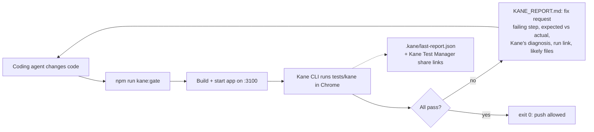

# Rails Desk

Rails Desk is a safety layer for AI agents that propose payments. An agent sends a request; the desk checks it against rules you set and returns **approved**, **needs your OK**, or **blocked**, with a SHA-256 hash-chained receipt. No real funds move. The `/demo` walkthrough is a mocked transfer held in page memory.

Live: [rails-desk.vercel.app](https://rails-desk.vercel.app) · Code: [github.com/Bamioishim/rails-desk](https://github.com/Bamioishim/rails-desk)

## How it works

1. Open **/rails**. A desk is created for you; your owner key stays in this browser.
2. Set your rules: allowed recipients, a maximum per action, and a review limit.
3. Copy the agent key from **Connect your agent** and give it to your agent.
4. The agent proposes a payment. The desk checks a valid amount under the cap, a case-insensitive allowlist match, and the review limit, then records the decision on a SHA-256 receipt chain.

The agent's key can propose and read status, but cannot change rules or approve its own proposals. Keys are stored only as SHA-256 hashes. A reason the agent writes is treated as data, never as an instruction.

Default rules are recipients Alex, Jordan and Sam, a maximum of 20, and a review limit of 10. Proposals above the review limit appear on **/receipts** under *Needs your OK* with Approve / Refuse.

## Local setup

Requires Node.js 20+ and npm.

```bash
npm ci
npm run dev
```

Open http://localhost:3000. The landing page is `/`, the interactive walkthrough is `/demo`, your desk is `/rails`, and the review queue and receipt chain are `/receipts`.

```bash
npm test
npm run lint
npm run build
```

## Use it with your own agent

```bash
curl -X POST https://<your-deployment>/api/v1/proposals \
  -H "Authorization: Bearer rd_agent_..." \
  -H "Content-Type: application/json" \
  -d '{"amount": 8, "recipient": "Alex", "reason": "Logo design invoice"}'
# → {"id":"prop_…","status":"approved" | "needs_review" | "blocked","reasons":[…],"receipt_id":"rcpt_…", …}
```

| Endpoint | Key | Purpose |
|---|---|---|
| `POST /api/v1/desks` | none | Create a desk; returns `ownerKey` and `agentKey` |
| `GET /api/v1/desk` | owner | Rules, proposals, receipts, chain check |
| `PUT /api/v1/desk` | owner | Replace rules `{allowedRecipients, maxPerAction, reviewLimit}` |
| `POST /api/v1/desk/agent-key` | owner | Rotate the agent key |
| `POST /api/v1/proposals` | agent or owner | Propose `{amount, recipient, reason}` |
| `GET /api/v1/proposals/:id` | agent or owner | Read status, e.g. after review |
| `POST /api/v1/proposals/:id/decision` | owner | `{decision: "approve" \| "refuse"}` |

**MCP:** download [`/rails-desk-mcp.mjs`](https://rails-desk.vercel.app/rails-desk-mcp.mjs) (no dependencies) and add it to your MCP client with `RAILS_DESK_URL` and `RAILS_DESK_AGENT_KEY`. Tools: `propose_payment`, `get_proposal`.

**Storage:** Upstash Redis when `KV_REST_API_URL` / `KV_REST_API_TOKEN` (or `UPSTASH_REDIS_REST_URL` / `UPSTASH_REDIS_REST_TOKEN`) are set, which is the free Vercel Marketplace integration. Otherwise JSON files in `data/desks` (or `RAILS_DESK_DATA_DIR`). On Vercel without Redis, files go to `/tmp` and can be cleared; the app says so.

Kane browser tests need `LT_USERNAME` and `LT_ACCESS_KEY` in the environment or a gitignored `.env`. Never commit those values.

## Earlier file receipt log

A previous demo flow still has a JSON Lines log at `data/receipts.jsonl`, checked by `npm run receipts:verify` and written by `npm run receipts:append` or `POST /api/receipts`. The `/receipts` page shows that log as "Earlier demo history" when it has entries, and any leftover browser `localStorage` receipts as preserved legacy history. That file log is not the desk receipt chain, is not what the agent API writes to, and is not durable on Vercel.

## Verified with Kane CLI

Rails Desk is built by an AI coding agent and verified by [Kane CLI](https://www.testmuai.com/kane-cli/) from TestMu AI. Kane drives a real Chrome through the flows in `tests/kane/*_test.md`, written in plain English, and decides pass or fail. Its verdict goes straight back to the coding agent: **the agent isn't done until Kane is green.**

There are **5** plain-English tests in `tests/kane/`:

- `landing-demo-entry_test.md` — landing page opens `/demo` and `/rails`
- `demo-walkthrough_test.md` — Play walkthrough runs approved, needs your OK, and blocked
- `demo-blocked-wording_test.md` — a blocked payment says "Blocked" everywhere
- `demo-approve-execute_test.md` — review, approve, then mock execution
- `app-agent-review_test.md` — set rules, an agent proposes, the owner approves on `/receipts`

The latest gate run is in [`KANE_REPORT.md`](KANE_REPORT.md) (commit `6f90b00`, 2026-11-20). It ran **2 of those 5 tests, and both passed** (2/2): the narrated walkthrough and the landing-page entry. The other three tests were not in that run. Evidence, including earlier runs of the tests that were not re-run, is in [`docs/kane-evidence/`](docs/kane-evidence/).

### The loop



- **`scripts/kane-gate.mjs`** (`npm run kane:gate`) builds the app, starts it, runs Kane with `kane-cli testrun run --agent`, and parses Kane's NDJSON stream and per-test session logs. It writes `.kane/last-report.json` (machine-readable) and `KANE_REPORT.md`, then exits **1 on any failure** (2 on setup errors).
- **`KANE_REPORT.md` is a re-prompt for the agent.** On failure it contains a "Fix request for the coding agent" section with the failing step, expected vs actual values, Kane's own diagnosis, the Kane run link (video, steps, screenshots) and the source files and lines that contain the words Kane flagged.
- **Agents are told to use it.** [`AGENTS.md`](AGENTS.md), [`CLAUDE.md`](CLAUDE.md) and [`.cursor/rules/kane-gate.mdc`](.cursor/rules/kane-gate.mdc) require the agent to run the gate after every change and keep fixing until the report says PASS.
- **Red blocks shipping.** `npm run hooks:install` enables a [`pre-push`](.githooks/pre-push) hook that runs the gate. Skip a docs-only push with `KANE_SKIP=1 git push`. [`ci/kane-gate.yml`](ci/kane-gate.yml) is a GitHub Actions workflow that runs it on every PR. Copy it into `.github/workflows/` and add the repo secrets `LT_USERNAME` and `LT_ACCESS_KEY`. Without secrets it skips instead of failing, so forks and Vercel builds don't break.

### Fail → fix → pass (real runs, 20 Nov 2026)

| Step | Commit | What happened | Evidence |
|---|---|---|---|
| Kane **fails** on wording | `aeaaaaf` | A blocked Mallory payment showed "Refused" instead of "Blocked". | [fail report](docs/kane-evidence/01-fail-blocked-wording.md) · [Kane run](https://test-manager.lambdatest.com/projects/01M7TXC9HAMFHFKZW2RB009S89/test-cases/01M7V42Y8RGH4SV1G359VKGHA9/dashboard/share/US_P7CB193IJEGDZKRFM5YY8NAVGX0FNX37A7XTQO2DMU1W4TZEJYRCZDUVI8RQ1ZSI?type=summary&agentView=true&fqdn=summary-page) |
| Agent fixes it, Kane **passes** | `ff8324b` | The pill and receipt say "Blocked". Gate: 2/2 passed (blocked wording and review-then-mock-execution). | [pass report](docs/kane-evidence/02-pass-after-fix.md) · [blocked wording](https://test-manager.lambdatest.com/projects/01M7TXC9HAMFHFKZW2RB009S89/test-cases/01M7V4B2ZPR2385DHFEQ5YTKAM/dashboard/share/US_P3UHDPTDQOOJY06X17SDZP86GVU4VQ2ID5F5YEXHGTF0K3AANJ2KXAUEAVOGE03I?type=summary&agentView=true&fqdn=summary-page) · [approve and execute](https://test-manager.lambdatest.com/projects/01M7TXC9HAMFHFKZW2RB009S89/test-cases/01M7V469NHMNNG6YH5DY9CQNZA/dashboard/share/US_54OA1K2MR6POQAYZCG6L26E9209WUQKQ8DOYTHKJ0ML4LQJS4AKKTDCPQ3DF45FN?type=summary&agentView=true&fqdn=summary-page) |
| Kane **fails** on the walkthrough | `e2a32f7` | After the walkthrough moved on, earlier receipts had vanished and "Needs your OK" had flashed past. `app-agent-review_test.md` passed in the same run. | [fail report](docs/kane-evidence/03-fail-walkthrough-forgets-results.md) · [walkthrough fail](https://test-manager.lambdatest.com/projects/01M7TXC9HAMFHFKZW2RB009S89/test-cases/01M7V50V18394NZXAKFXA9Y689/dashboard/share/US_9ENOB7M7IKTR78CK75QLKA5Y75EG2Q73J1QMSLY6IGFOH8LEF6I30BR4UILHIMS0?type=summary&agentView=true&fqdn=summary-page) · [app-agent-review pass](https://test-manager.lambdatest.com/projects/01M7TXC9HAMFHFKZW2RB009S89/test-cases/01M7V4SY2BT8HXPNPFSPZVTRPQ/dashboard/share/US_79W1EI5G6P1YQ1A4S2UJDWH4JHZU3QJRLIHSY8M4NELC5P518NXKTE3HOA4UH3AA?type=summary&agentView=true&fqdn=summary-page) |
| Agent fixes it, Kane **passes** | `537cdfd` | The finished walkthrough keeps all three receipts, and "Needs your OK" is held long enough to see. Gate: 1/1 passed. | [pass report](docs/kane-evidence/04-pass-walkthrough-and-app.md) · [Kane run](https://test-manager.lambdatest.com/projects/01M7TXC9HAMFHFKZW2RB009S89/test-cases/01M7V594YAP48124F6NGTDSP89/dashboard/share/US_M3YZA9Y1HK6LWXOOV2N3LW6BLI2Y2W99BUG3NQG485GBXRHJYJ6H6128ZDWO95TP?type=summary&agentView=true&fqdn=summary-page) |
| Latest gate run | `6f90b00` | 2/2 passed: narrated walkthrough and landing-page entry to `/demo` and `/rails`. The other three tests were not re-run. | [`KANE_REPORT.md`](KANE_REPORT.md) · [saved copy](docs/kane-evidence/05-pass-narrated-demo-and-open-app.md) · [walkthrough](https://test-manager.lambdatest.com/projects/01M7TXC9HAMFHFKZW2RB009S89/test-cases/01M7V6TGSDVQKVA0QWVQ1TH436/dashboard/share/US_W8XN2AOG5L3ZPX2VLPT5MHG6YYNMTWNA2B2BJCD5ZX8PY01HDAF9Q93CAJW9YECK?type=summary&agentView=true&fqdn=summary-page) · [landing entry](https://test-manager.lambdatest.com/projects/01M7TXC9HAMFHFKZW2RB009S89/test-cases/01M7V6YW19TP5NW67XGZHF6RMW/dashboard/share/US_ZJAR5Q0CD4CXA8SVDJDXVVR9WIAWG3UA9YS7G9LXCKJ4EIOH7JKAH00JNS8MMXSU?type=summary&agentView=true&fqdn=summary-page) |

Kane caught issues unit tests could not: the policy logic was right, but the screen used the wrong word, and a walkthrough hid earlier outcomes once it moved on.

### Run it

```bash
npm install -g @testmuai/kane-cli@0.10.6        # once; Chrome must be installed
# LT_USERNAME / LT_ACCESS_KEY in your env or a gitignored .env
npm run kane:gate                               # build, start, test everything, write KANE_REPORT.md
npm run kane:gate -- --match demo-blocked       # only matching tests (saves credits while iterating)
npm run kane:gate -- --url https://my-preview.vercel.app   # test a deployment instead
npm run kane:gate -- --from .kane/runs/<ts>/kane-stdout.ndjson   # re-render a saved run, no credits
npm run hooks:install                           # block git push on a red gate
```

Tests stay in demo (mock) mode: no wallet connection and no real transfers (see `.testmuai/context.md`). Credentials are read only from the environment and are never printed, logged or committed. The older `npm run test:kane` runner (`scripts/run-kane-tests.sh`, `BASE_URL`, default `http://127.0.0.1:3000`) still works for ad-hoc runs against an app you started yourself.
